<h1 align="center">
  LE ANH VIET
</h1>

  

  &nbsp;&nbsp;

 

  Final-year IT student at PTIT (Hanoi) · Available for part-time onsite 2–3 days/week · Full-time from 2027

## Focus

- **Backend:** C#/.NET 8, ASP.NET Core, REST API, SQL Server/PostgreSQL, RabbitMQ, Docker
- **Applied ML:** Python, PyTorch, FastAPI, XGBoost, NLP (PhoBERT/FastText)
- **QA Automation:** Playwright, TypeScript, API/E2E testing, test plans, defect reports

## Featured projects

- **[Todo App — Playwright E2E/API portfolio](https://github.com/Nerduckk/Todo-app/tree/main/e2e)** — 25 Playwright tests (16 API + 9 UI), ephemeral MySQL, deterministic seed data, one-command runner, test plan and defect log.
- **[Audio2MBTI](https://github.com/Nerduckk/Audio2MBTI)** — audio → CNN embeddings → XGBoost → FastAPI → React; includes evaluation metrics and limitations.
- **Ride-hailing microservices** — .NET 10, PostgreSQL, RabbitMQ, Redis, Docker, OpenTelemetry; private team repo, code walkthrough on request.

 

  
  

 
 

  <picture>
    <source media="(prefers-color-scheme: dark)" srcset="https://raw.githubusercontent.com/Nerduckk/Nerduckk/output/github-contribution-grid-snake-dark.svg">
    <source media="(prefers-color-scheme: light)" srcset="https://raw.githubusercontent.com/Nerduckk/Nerduckk/output/github-contribution-grid-snake.svg">
    
  </picture>

 
